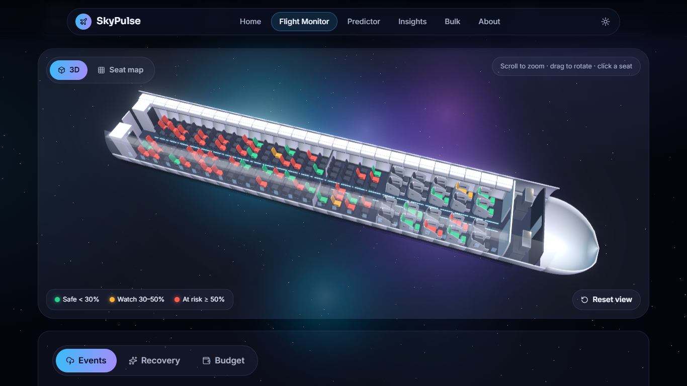
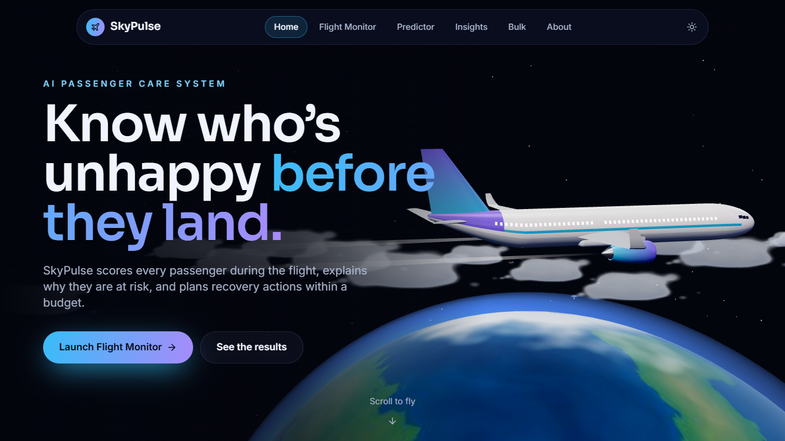
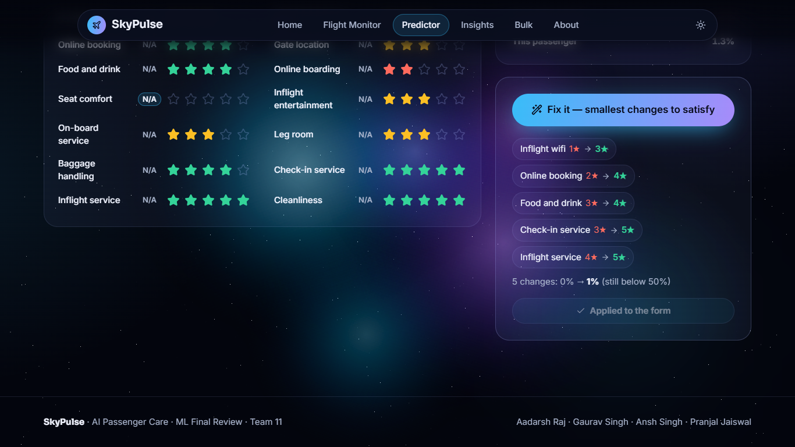
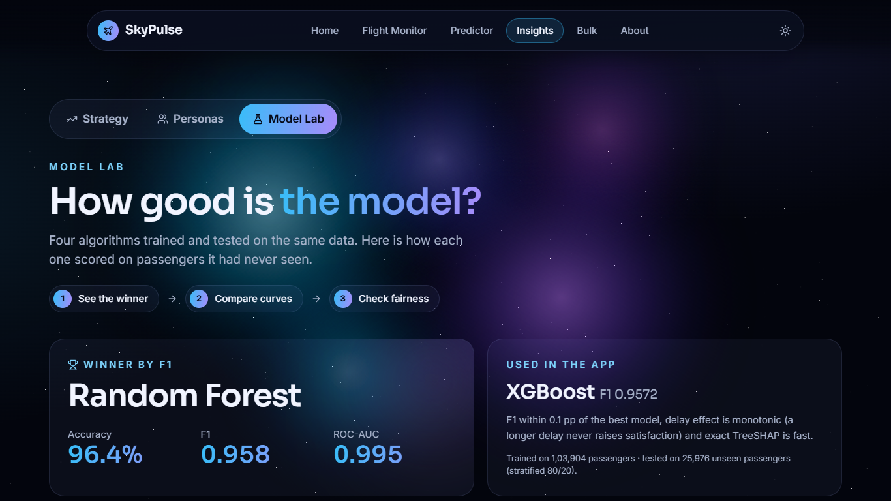

# SkyPulse — AI Passenger Care System

**Know who's unhappy before they land.** SkyPulse predicts which airline passengers are at risk of an unsatisfying flight *during* the journey, explains why with SHAP, and recommends recovery actions that fit a budget.



> Designed and built by Aadarsh Raj. Developed as the Team 11 project for Machine Learning for Data Analytics, SRMIST (team: Pranjal Jaiswal, Gaurav Singh, Ansh Singh).

## The problem
Airlines usually find out a passenger was unhappy only after the flight, through a survey or a complaint, when it is too late to fix. In the 129,880-passenger dataset used here, **56.5% of passengers were not satisfied**. SkyPulse moves that signal into the flight itself so the crew can act while the passenger is still on board.

## Features
| Page | What it does |
|---|---|
| **Flight Monitor** | Build a flight from real dataset passengers, an uploaded CSV manifest, or by hand. A 3D cabin (or flat seat map) colours every seat by risk. Apply events (delays, wifi outage, meal shortage, turbulence), run **Auto-Recover**, or plan actions with a **budget optimizer**. Click a seat for its SHAP reasons and the smallest fix. Flights are saved to SQLite with a timeline. |
| **Predictor** | Score one passenger with live gauge, SHAP waterfall and "Fix it" before→after chips. Compare with the weaker booking-time model. |
| **Insights** | Strategy simulator (lift from improving one service across 25,976 test passengers), 6 K-Means personas in a 3D map, and a Model Lab with ROC curves, confusion matrices, SHAP importance and fairness. |
| **Bulk** | Upload a CSV, get a risk summary and a sortable table, download the results. Try `sample_passengers.csv`. |

Dark and light themes, mobile layout, reduced-motion support, and works offline after setup.

| | |
|---|---|
|  |  |
|  | |

## ML results
Stratified 80/20 split (103,904 train / 25,976 test), hyper-parameters tuned with `RandomizedSearchCV` (3-fold, F1).

| Model | Accuracy | Precision | Recall | F1 | ROC-AUC |
|---|---|---|---|---|---|
| Logistic Regression | 0.8745 | 0.8704 | 0.8355 | 0.8526 | 0.9283 |
| SVM (RBF) | 0.9465 | 0.9482 | 0.9274 | 0.9377 | 0.9865 |
| Random Forest **(best F1)** | 0.9637 | 0.9728 | 0.9428 | **0.9576** | 0.9947 |
| XGBoost *(served in app)* | 0.9634 | 0.9725 | 0.9423 | 0.9572 | **0.9954** |
| Booking-time XGBoost (6 features) | 0.8000 | 0.7726 | 0.7649 | 0.7687 | 0.8612 |

- The app serves **XGBoost**: F1 within 0.1 pp of Random Forest, a monotonic constraint so a longer delay never raises satisfaction, and fast exact TreeSHAP.
- Top drivers (mean |SHAP|): inflight wifi, type of travel, online boarding, customer type, class.
- Fairness: accuracy stays within 0.96–0.97 across gender and age groups.

Full details: [RESULTS.md](RESULTS.md) and the notebook [ML_Team11_Final.ipynb](ML_Team11_Final.ipynb).

## Tech stack
- **ML:** Python, pandas, scikit-learn, XGBoost, SHAP, K-Means
- **Backend:** FastAPI, SQLite, pytest
- **Frontend:** React, Vite, TypeScript, Tailwind CSS, Framer Motion, React Three Fiber, Recharts
- **3D:** own models built with Python scripts in Blender (`tools/blender/`)
- **QA:** Playwright end-to-end suite across 3 screen sizes × dark/light

## How to run
Requirements: **Python 3.12** ([download](https://www.python.org/downloads/), tick "Add Python to PATH") and **Node.js 18+** ([download](https://nodejs.org/)). Internet is needed on the first run.

```bash
git clone https://github.com/xaadarsh/skypulse.git
```

Then double-click **`start.bat`** in the project folder (macOS/Linux: `./start.sh`). It will:
1. create a Python virtual environment and install `requirements.txt`,
2. download the dataset and train the models if needed,
3. install and build the web app,
4. start the API (port 8000) and the web app, and open <http://localhost:5173>.

Close the two server windows to stop it.

Run the backend tests:
```bash
.venv\Scripts\python -m pytest backend/tests -q
```

## Project layout
```
ml/            pre-processing, training, notebook and results generators
backend/       FastAPI API, scoring/SHAP/recovery engine, pytest suite
frontend/      React web app (3D models, textures and fonts in public/)
tests/         Playwright QA and end-to-end checks
tools/         Blender and texture generation scripts
```

## Dataset credit
[Airline Passenger Satisfaction](https://www.kaggle.com/datasets/teejmahal20/airline-passenger-satisfaction) by **TJ Klein** on Kaggle. The CSV files are not stored in this repository; they are downloaded on first run.

## License
Code released under the [MIT License](LICENSE). Recovery action prices in the app are assumed values (see `backend/engine.py`).
